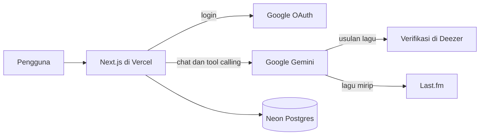

# Moodify

> A mood-aware music chatbot. Tell it how you feel, get songs that fit.

Moodify adalah chatbot musik berbahasa Indonesia. Kamu menceritakan perasaanmu atau menyebut satu lagu, lalu chatbot mencarikan lagu dengan vibes yang pas, lengkap dengan cuplikan 30 detik dan tautan ke Spotify atau YouTube Music. Obrolanmu tersimpan, dan mood yang kamu ceritakan dicatat menjadi riwayat mood yang bisa dilihat kembali. Aplikasinya bisa dipasang di layar utama ponsel seperti aplikasi biasa.

## Fitur

- Rekomendasi lagu dari cerita mood atau dari satu lagu acuan, termasuk lagu Indonesia.
- Permintaan lanjutan seperti "mau lagi" atau "yang lebih sedih" dipahami dari riwayat obrolan, dan lagu yang sudah tampil tidak diulang.
- Putar cuplikan 30 detik di dalam aplikasi, plus tautan pencarian ke Spotify dan YouTube Music.
- Login dengan Google. Pemilih akun selalu tampil, dan ada tombol Ganti akun di halaman Akun.
- Riwayat obrolan tersimpan, bisa dibuka kembali dan dihapus.
- Riwayat mood: grafik mood yang paling sering muncul dan kalender mood 28 hari.
- Hapus akun beserta seluruh data dari dalam aplikasi.
- Bisa dipasang di layar utama (PWA) dan menampilkan halaman pemberitahuan saat offline.
- Pembatas permintaan per pengguna dan pesan error yang ramah saat kuota model habis.

## Teknologi

| Bagian | Pilihan |
| --- | --- |
| Framework | Next.js 16 (App Router, Turbopack), React 19, TypeScript |
| Tampilan | Tailwind CSS v4, shadcn/ui, Motion, Lenis, lucide-react |
| AI | Vercel AI SDK, Google Gemini (tool calling dan streaming) |
| Data musik | Last.fm API (kemiripan lagu), Deezer API (verifikasi, sampul, cuplikan) |
| Autentikasi | Better Auth dengan Google OAuth |
| Database | PostgreSQL di Neon, Prisma 7 |
| PWA | Web App Manifest, service worker minimal untuk halaman offline |
| Hosting | Vercel |

## Arsitektur



Alur satu pesan:

1. Browser mengirim riwayat obrolan ke `/api/chat`. Server memeriksa sesi login dan pembatas permintaan.
2. Gemini memilih tool: `suggestTracks` (memilih lagu sendiri), `recommendSimilarTo` (lagu mirip lewat Last.fm), `recommendByMood` (cadangan berbasis tag), atau `logMood` (mencatat mood).
3. Setiap lagu yang diusulkan dicocokkan dengan katalog Deezer berdasarkan judul dan artis. Hanya lagu yang terbukti ada yang ditampilkan.
4. Hasil mengalir ke browser sebagai kartu lagu. Setelah balasan selesai, obrolan disimpan ke database.

## Keputusan teknis

**Tidak memakai Spotify API.** Rencana awal adalah login Spotify. Menurut dokumentasi Spotify untuk Development Mode (perubahan Februari 2026), pemilik aplikasi harus berlangganan Premium dan aplikasi dibatasi 5 pengguna. Syarat itu tidak cocok untuk proyek yang ingin dicoba semua orang, jadi data musik diambil dari Last.fm dan Deezer, dan Spotify hanya muncul sebagai tautan pencarian.

**LLM mengusulkan, katalog memverifikasi.** Model bahasa bisa mengarang judul lagu. Karena itu setiap usulan dicocokkan dengan Deezer secara ketat (judul dan artis harus sama), dan versi live, akustik, atau remix tidak diprioritaskan.

**Pengecualian lagu dilakukan di server.** Daftar lagu yang sudah pernah tampil dikumpulkan dari riwayat obrolan, lalu disaring di server sebelum hasil dikirim. Hasilnya konsisten walaupun model tidak patuh pada instruksi.

**Better Auth, bukan Auth.js.** Tim Auth.js bergabung ke Better Auth dan merekomendasikannya untuk proyek baru.

**Pembatas permintaan disimpan di database.** Di lingkungan serverless, penghitung di memori tidak dibagi antar instance, jadi penghitung per pengguna disimpan di Postgres.

**Obrolan disimpan sebagai JSON.** Pesan UI disimpan apa adanya, sehingga obrolan bisa dipulihkan lengkap dengan kartu lagunya tanpa pemetaan tambahan. Tautan cuplikan Deezer punya batas waktu, jadi diminta ulang otomatis saat gagal diputar.

**Mood adalah perkiraan.** Mood dicatat oleh model sebagai perkiraan, bukan diagnosis. Hal ini dinyatakan di halaman riwayat mood dan di kebijakan privasi, dan menghapus obrolan ikut menghapus mood dari obrolan itu.

**PWA dengan service worker minimal.** Service worker hanya menampilkan halaman offline saat perpindahan halaman gagal karena tidak ada koneksi. Ia sengaja tidak menyimpan halaman, data obrolan, atau respons API di cache. Aplikasi ini memuat data pribadi dan selalu butuh jaringan, jadi cache yang agresif hanya menambah risiko data basi atau data akun lain yang tersisa di perangkat bersama. Halaman offline dibuat sebagai HTML mandiri karena saat offline berkas JavaScript dan CSS aplikasi tidak bisa dimuat. Ikon aplikasi dirender dari trace vektor logo, bukan diperkecil dari gambar raster, supaya tetap tajam di layar beresolusi tinggi.

## Struktur folder

```text
src/
  app/               route Next.js (halaman, API, manifest)
  features/
    auth/            login, ganti akun, halaman akun, hapus akun
    chat/            UI chat, tool Gemini, riwayat obrolan
    landing/         landing page
    legal/           kebijakan privasi
    mood/            pencatatan dan halaman riwayat mood
    music/           layanan Last.fm dan Deezer, kartu lagu, pemutar
    pwa/             pemasangan aplikasi dan pendaftaran service worker
  shared/            komponen, konstanta, dan utilitas bersama
prisma/              skema database
public/
  icons/             ikon PWA (biasa dan maskable)
  sw.js              service worker
  offline.html       halaman saat offline
```

Setiap fitur punya `components`, `constants`, `hooks`, `services`, dan `types` sendiri. Aturan dependensinya satu arah: `app` memakai `features` dan `shared`, `features` memakai `shared`.

## Menjalankan secara lokal

Prasyarat: Node.js, pnpm, akun Neon, akun Google Cloud (OAuth client), API key Last.fm, dan API key Gemini.

```bash
git clone https://github.com/dindaatikah211/moodify.git
cd moodify
pnpm install
cp .env.example .env
pnpm db:push
pnpm dev
```

Buka `http://localhost:3000`. Service worker hanya didaftarkan pada build produksi, jadi fitur PWA seperti halaman offline diuji di domain hasil deploy atau lewat `pnpm build` lalu `pnpm start`.

### Variabel environment

| Variabel | Keterangan |
| --- | --- |
| `DATABASE_URL` | Connection string Neon (pooled) |
| `DATABASE_URL_UNPOOLED` | Connection string Neon (direct), dipakai Prisma CLI |
| `BETTER_AUTH_SECRET` | String acak untuk menandatangani sesi |
| `BETTER_AUTH_URL` | URL aplikasi, misalnya `http://localhost:3000` |
| `GOOGLE_CLIENT_ID` | OAuth client ID Google |
| `GOOGLE_CLIENT_SECRET` | OAuth client secret Google |
| `GOOGLE_GENERATIVE_AI_API_KEY` | API key Gemini |
| `LASTFM_API_KEY` | API key Last.fm |
| `CHAT_MODEL_ID` | Opsional. ID model Gemini, bawaannya `gemini-3.1-flash-lite` |

Untuk login lokal, daftarkan `http://localhost:3000/api/auth/callback/google` sebagai redirect URI di Google Cloud Console.

### Database

Gunakan branch Neon terpisah untuk development supaya data produksi tidak tercampur.

```bash
pnpm db:push        # terapkan skema ke database di .env
pnpm db:push:prod   # terapkan skema ke produksi, membaca .env.prod-migrate
```

## Deploy ke Vercel

1. Impor repositori di Vercel dan isi semua variabel environment di atas untuk Production.
2. Tambahkan `https://<domain>` ke Authorized JavaScript origins dan `https://<domain>/api/auth/callback/google` ke Authorized redirect URIs di Google Cloud Console.
3. Ubah status aplikasi OAuth ke "In production" agar semua akun Google bisa masuk. Ini butuh halaman kebijakan privasi (`/privacy`).
4. File `vercel.json` menjalankan fungsi di region Singapura, dekat dengan database.
5. Konfigurasi `next.config.ts` menambahkan header khusus untuk `/sw.js` supaya pembaruan service worker tidak tertahan di cache browser.

## Memasang sebagai aplikasi

- **Android (Chrome):** buka situsnya, lalu klik Pasang aplikasi di landing page atau halaman Akun, atau lewat menu browser.
- **iPhone (Safari):** ketuk tombol Bagikan, lalu pilih Tambah ke Layar Utama.

Setelah dipasang, aplikasi terbuka layar penuh langsung ke halaman obrolan. Aplikasi tetap butuh internet: tanpa koneksi, yang tampil hanya halaman pemberitahuan offline.

## Batasan yang diketahui

- Cuplikan lagu hanya 30 detik karena berasal dari Deezer. Pemutaran penuh belum tersedia.
- Cakupan Last.fm untuk lagu Indonesia tipis, sehingga permintaan lagu lokal mengandalkan usulan model yang diverifikasi di Deezer. Kualitasnya bergantung pada pengetahuan musik model.
- Kuota gratis Gemini terbatas. Saat habis, pengguna melihat pesan bahwa layanan sedang ramai.
- Pencatatan mood bergantung pada model dan bisa salah menebak.
- Mode offline hanya berupa halaman pemberitahuan. Obrolan dan pencarian lagu tidak tersedia tanpa internet.

## Kredit

- Data musik: [Last.fm](https://www.last.fm/api) dan [Deezer](https://developers.deezer.com/api).
- Model bahasa: Google Gemini.

Dibuat oleh Dinda Atikah Ghaisani